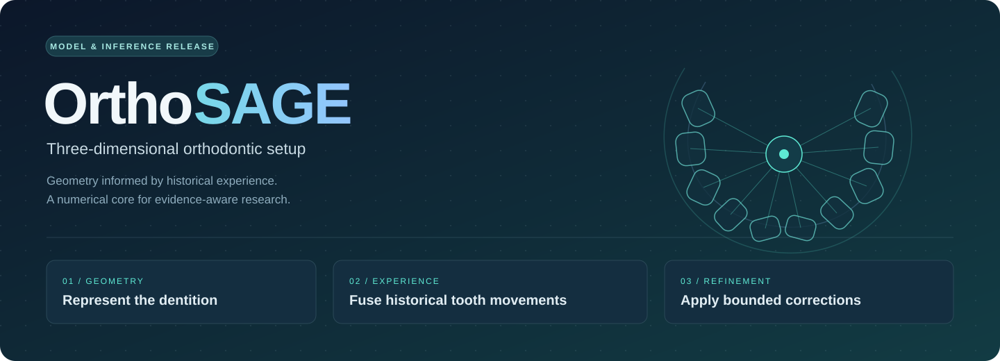
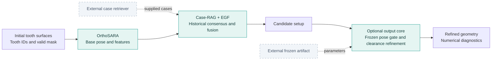

<div align="center">



### Combining historical experience and clinical knowledge<br>for three-dimensional orthodontic setup

**Dengke Liu · Yuntao Mao · Ziwei Chen · Dongliang Zhang · Jiaxiang Zhang**

Beijing Jiaotong University · Capital Medical University


[Overview](#overview) · [Architecture](#architecture) · [Getting started](#getting-started) · [Release scope](#release-scope) · [Data](#data)

</div>

---

## Overview

Orthodontic setup prediction involves both the geometry of individual teeth and their relationships within a dental arch. **OrthoSAGE** studies how historical tooth movements and explicit clinical evidence can support this process.

The research framework combines **OrthoSARA** pose prediction, **Case-RAG** historical guidance, **experience-guided fusion (EGF)**, and **GraphRAG** structural assessment. Its central research goal is to make the basis of refinement inspectable: which previous cases supplied guidance, which rules were relevant, and which literature supported an action.

This repository contains the **DualRAG-V8 model and numerical inference core**. It exposes interfaces for retrieved cases and their provenance, together with bounded output refinement.

> [!IMPORTANT]
> This is a **model-only release**. The case search/index pipeline, clinical knowledge retrieval, literature evidence tracing, training code, pretrained weights and frozen refiner artifact are not included. The full evidence-traceable workflow described in the manuscript requires those additional components.

<table>
<tr>
<td width="33%" valign="top">

**01 · Represent**

Encode tooth surfaces and anatomical relationships to predict initial rigid poses.

</td>
<td width="34%" valign="top">

**02 · Retrieve & fuse**

Fuse externally retrieved, anatomically matched historical movements with the current prediction.

</td>
<td width="33%" valign="top">

**03 · Refine**

Apply frozen, quality-gated pose corrections and bounded local-clearance optimization.

</td>
</tr>
</table>

## Architecture



*Solid blocks describe the included numerical path. Dashed inputs must be supplied externally. Literature retrieval and evidence-to-action auditing are outside this release.*

| Component | Entry point | Implementation |
| :--- | :--- | :--- |
| Base network | `ArchFormerAligner` / `M0PlusAligner` | Point-based tooth encoding, relation-aware Transformer and pose refinement |
| Historical inputs | `RetrievedCaseBatch` | Matched source/target surfaces, historical poses, scores and optional provenance |
| Fusion | `LongHorizonCaseRAGOrthoSARA` | Weighted pose consensus, same-position cross-attention and bounded residuals |
| Output refinement | `OutputGraphRAG` | Frozen linear residual and quality heads, followed by clearance optimization |
| Pipeline wrapper | `DualRAGV8` | Input fusion, coordinate recovery and optional output refinement |
| Weight loading | `load_v8_weights` | Strict checkpoint loading with optional EMA parameters |

### Selected implementation defaults

| Input fusion | Value | Output refinement | Value |
| :--- | :--- | :--- | :--- |
| Expert-token dimension | 384 | State / gate dimensions | 59 / 67 |
| Attention heads | 8 | Residual shrinkage | 0.5 |
| Retrieval-score temperature | 20 | Rotation / translation caps | 2° / 0.08 mm |
| Prior blend at full strength | 0.24 | Local clearance threshold | 0.2 mm |
| Residual gate cap | 0.10 | Translation optimization | 12 Adam steps |
| Pre-gate residual scales | 2° / 0.02 normalized units | Candidate displacement scales | 1, 1/2, 1/4, 1/8 |

These are code defaults; the loaded artifact may supply its own output configuration. The sampled-distance clearance measure is a geometric proxy, not a mesh-intersection or clinical-feasibility test.

## Getting started

### 1. Set up the environment

The source uses Python 3.10+ syntax. Choose a Python version supported by your PyTorch build and install PyTorch for your CPU/CUDA platform using the [official installation selector](https://pytorch.org/get-started/locally/).

```bash
git clone https://github.com/ldk-coder/orthoSAGE.git
cd orthoSAGE
python -m pip install -r requirements.txt
```

`torch` is the only third-party import in the model file. The requirements file does not pin the original experimental environment; installing dependencies alone does not reproduce the manuscript results.

### 2. Inspect the network

```python
from dualrag_v8_model import build_input_dualrag_v8

model = build_input_dualrag_v8()
print(type(model).__name__)
print(f"Parameters: {sum(p.numel() for p in model.parameters()):,}")
```

This constructs a randomly initialized network. It is useful for inspection, not for meaningful setup prediction. The freshly constructed fusion branch starts with `rag_strength = 0.0`; the checkpoint loader restores its saved strength, defaulting to 1.0 if that field is absent.

### 3. Integrate inference

The following function expects a compatible checkpoint and caller-prepared tensors. **Neither the weights nor the retrieved data are bundled.**

```python
import torch
from dualrag_v8_model import (
    DualRAGV8,
    OutputGraphRAG,
    build_input_dualrag_v8,
    load_v8_weights,
)


def predict_setup(
    src_points, tooth_ids, mask, retrieved, checkpoint_path,
    *, refiner_path=None, case_center=None, scale=None,
):
    device = src_points.device
    input_model = build_input_dualrag_v8().to(device)
    load_v8_weights(input_model, checkpoint_path, map_location=device)

    refiner = None
    if refiner_path is not None:
        refiner = OutputGraphRAG.from_artifact(refiner_path).to(device)

    model = DualRAGV8(input_model, refiner).eval()
    # no_grad permits the output refiner's local enable_grad block.
    # Do not wrap clearance optimization in torch.inference_mode().
    with torch.no_grad():
        return model(
            src_points, tooth_ids, mask, retrieved.to(device),
            case_center=case_center, scale=scale,
        )
```

Only load trusted checkpoints: `load_v8_weights` uses PyTorch checkpoint deserialization with `weights_only=False`.

The wrapper returns `input_case_rag`, with poses, normalized predicted points, consensus weights, attention and any supplied retrieval provenance. When a refiner is provided, it also returns `output_graph_rag`, containing millimetre-space geometry, global poses and numerical diagnostics.

See **[the input and artifact guide](docs/INTEGRATION.md)** for tensor shapes, coordinate conventions and artifact fields.

## Release scope

| Included | Supplied externally / not included |
| :--- | :--- |
| OrthoSARA `anat_a2` backbone | Pretrained model checkpoint |
| Historical consensus and EGF | Case descriptor, memory bank and search index |
| Optional case identity/trace fields | Case eligibility, deduplication and provenance construction |
| Frozen output-head inference | Fitted residual/gate parameters and their training pipeline |
| Bounded clearance optimization | Knowledge graph, rule retrieval and literature source records |
| Numerical diagnostics | Evidence-linked action audit and clinical-review routing |
| Geometry and checkpoint utilities | Dataset loaders, training losses, training loops and evaluation scripts |

The original Python file is preserved in this release. The output class retains its implementation name, `OutputGraphRAG`, but does not itself retrieve a clinical evidence subgraph. Its acceptance gate checks predicted benefits and valid teeth; it does not implement the manuscript's separate knowledge-rule permission check.

One additional manuscript-alignment issue remains: arch smoothness is computed after filtering out missing teeth, so the current code can bridge missing-tooth gaps. The supplementary description specifies that such gaps should not be bridged. Full-method reproduction requires resolving this difference.

## Data

The manuscript uses three existing data sources. Access and reuse remain subject to the original providers' terms; patient data are not redistributed in this repository.

| Source | Publication / repository | Access contact |
| :--- | :--- | :--- |
| Shanghai · CLIK-Diffusion | [Medical Image Analysis article](https://doi.org/10.1016/j.media.2025.103746) | Yulong Dou and Zhiming Cui, through the providers' data access agreement |
| Beijing | [Scientific Data article](https://doi.org/10.1038/s41597-024-04138-7) · [Zenodo](https://doi.org/10.5281/zenodo.11392406) | Yong-Jin Liu, subject to the providers' data use agreement |
| Hangzhou · TeethAlign3D | [Zenodo](https://doi.org/10.5281/zenodo.15834700) | Jiazhou Chen, under the providers' terms |

## Repository layout

```text
orthoSAGE/
├── README.md                 # Project overview and entry points
├── dualrag_v8_model.py        # Original model and inference module
├── requirements.txt          # Runtime dependency
├── assets/
│   └── hero.svg              # Self-contained project banner
└── docs/
    └── INTEGRATION.md        # Tensor and artifact contracts
```

## Manuscript

**Combining historical experience and clinical knowledge for three-dimensional orthodontic setup**  
Dengke Liu, Yuntao Mao, Ziwei Chen, Dongliang Zhang and Jiaxiang Zhang.

Publication metadata and a manuscript DOI are not included in this release. Please use verified bibliographic information when citing the work.

## License

No software license has been assigned in this release. Public repository access does not itself grant an open-source license. Please contact the authors regarding reuse.

---

<div align="center">
<sub>OrthoSAGE · 3D geometry · Historical experience · Evidence-aware research</sub>
</div>
